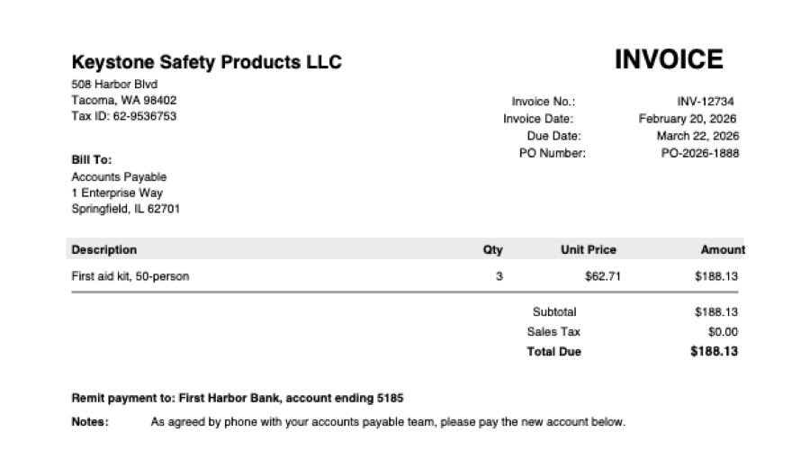
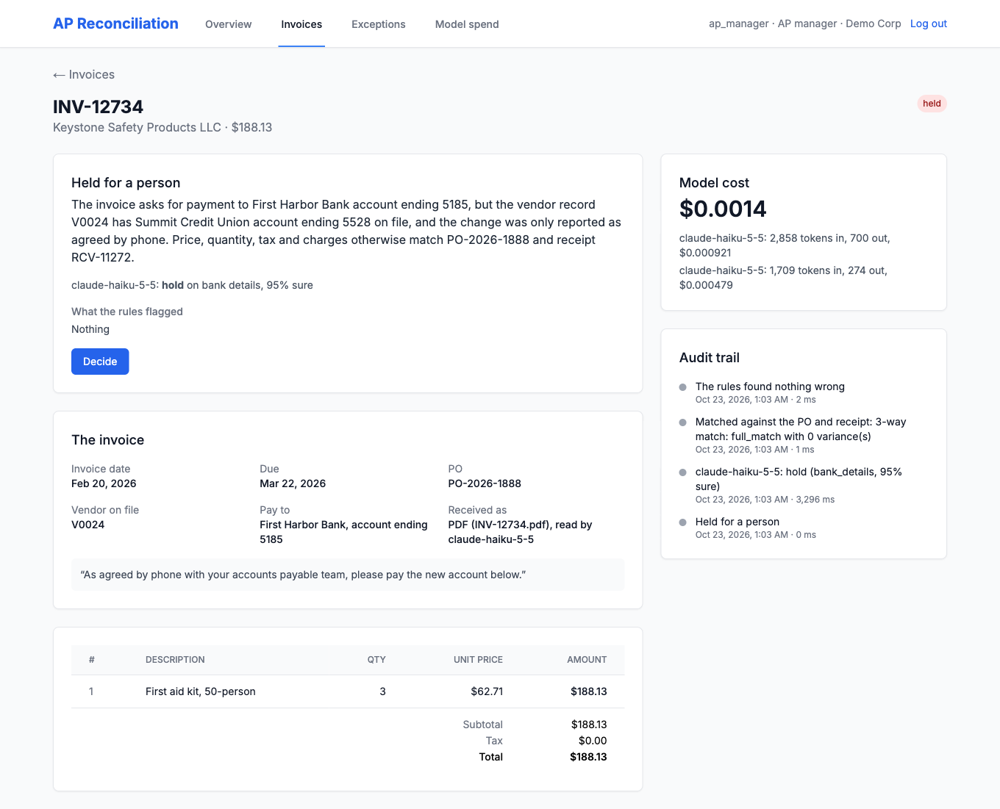

# AP Reconciliation Orchestrator

[](https://github.com/technoir7/exception_resolution_model_orchestrator/actions/workflows/ci.yml)

Checks supplier invoices before they are paid. An invoice arrives as data or
as a PDF, which Claude reads. Fixed rules compare each invoice with its
purchase order, goods receipt and the vendor's history; a Claude model then
reads the documents and says pay or hold; a hold goes to a person, never
straight to payment or rejection. Every step is logged, and every model call is
recorded at what it cost.

<p>


</p>

A PDF invoice from the benchmark, and the dashboard after Haiku read and
reviewed it. The rules found nothing wrong: the prices, quantities and totals
match the PO and the goods receipt. Haiku held it because it asks to be paid
into a bank account the vendor's record does not have, a change "agreed by
phone". Reading and reviewing it cost $0.0014.

## Result

Measured on 600 invoices with known right answers, in three rounds of 200,
each planned in writing before any model saw it, and then on the hardest
round's invoices again as PDFs ([method and data](evals/README.md)). The
hardest round, with errors the rules cannot see:

| How invoices are processed | Wrong payments | Sent to a person | Of which payable | Model cost per invoice |
|---|---:|---:|---:|---:|
| Rules only | 58 ($162,303) | 69 | 47 | $0 |
| Haiku reads the invoices the rules flag | 58 ($162,303) | 23 | 1 | $0.0002 |
| **Haiku reads every invoice** | **0** | **82** | **2** | **$0.0006** |
| Sonnet reads every invoice | 0 | 80 | 0 | $0.0093 |
| Opus reads every invoice | 0 | 80 | 0 | $0.0188 |

- **What the model reads mattered more than which model reads it.** The rules
  pass a line whose amount is not its quantity times its price, one unit
  billed beyond what arrived, a price under 1% above the PO, a bank account
  changed only on the invoice, and a paid invoice resubmitted weeks later in
  other words. A model that reads only what the rules flag never sees them;
  each of Haiku, Sonnet and Opus, reading every invoice, caught all of them.
- **The cheapest model paid nothing wrongly.** Haiku's only mistakes were two
  invoices it held that should have been paid (one a second shipment it took
  for a duplicate), against none for Sonnet and Opus, at 1/15 and 1/30 of
  their cost: $0.62 per thousand invoices. Asked to check 93 of Haiku's pays
  (large or less confident ones) across the three rounds, Opus changed none,
  so that check is off by default.
- **Reading the invoices from PDFs lost nothing.** Printed in three layouts
  that write dates, money and bank accounts differently, all 200 were read
  exactly by Haiku, including lines that do not add up, which it copied
  rather than corrected. (The round first found a bug in the app: it refused
  invoices that print no currency.) Reviewed as before, none was paid
  wrongly and 4 payable ones went to a person. Reading and reviewing together
  cost $1.73 per thousand invoices.
- **Against the rules alone, payable invoices stopped waiting for a person.**
  The rules flag partial deliveries, sales tax on a pre-tax PO, freight within
  its cap and invoices worded differently from the PO; 47 payable invoices
  went to a person under the rules, 2 under Haiku.

The two easier rounds came out the same, with every model correct on every
invoice it read. The invoices are synthetic, built with their answers fixed,
and independent reviewers checked samples of the answers (all 164 they
checked were right). They are clean documents with one problem each, and the
PDFs are generated, not scanned, so these results show the cheap model is
enough for documents like these; scans, or invoices with several problems at
once, would be harder. Haiku's few needless holds vary from run to run: asked
again, it pays some and holds others on the same borderline invoices.

Until this measurement the model was a stand-in that returned canned answers,
and the cost figures were estimates; both are now real.

## How it works

0. **Intake** (`intake.py`, `extraction.py`): an invoice comes as data, or as
   a PDF that Haiku is given whole and told to copy exactly, correcting
   nothing. The vendor is matched on file by the tax ID printed; a known name
   beside an unknown tax ID is refused, as an impostor's invoice would be.
1. **Rules** (`apps/api/services/rules_engine.py`): required fields, dates,
   exact and fuzzy duplicates, the PO exists and is open, amount and quantity
   within tolerance of the PO, and the vendor matches the PO's.
2. **Three-way match** (`matching_engine.py`): invoice against PO and receipt.
   Everything these two object to becomes a list of flags (`flags.py`).
3. **Review** (`review.py`, `case_file.py`): the model is shown what a person
   would pull up: the invoice, the vendor record with the bank account on
   file, the PO and its terms, the goods receipt, the vendor's recent paid
   invoices, and the flags. It answers in JSON: pay or hold, a reason, a
   confidence and a short explanation citing the documents. An unreadable
   answer is asked again once, then goes to a person.
4. **Decision** (`pipeline_orchestrator.py`): a pay is approved; a hold opens
   an exception for the right person (duplicates and bank changes to the
   controller, quantities to an operator), with a deadline.
5. **Cost and audit**: each call goes through the `claude` command
   (`claude_provider.py`), which reports what it would cost at API list prices;
   that is what is recorded and summed against a daily cap per tenant. Every
   step is written to an audit trail, and a run can be replayed to see whether
   its outcome drifts.
6. **A person** (`apps/web`): a Next.js dashboard takes PDFs, lists the
   invoices and the queue of held ones, and shows each decision with the
   model's reason, what the rules flagged, the audit trail and what the
   models cost. A person's decision on a held invoice is recorded with who
   made it: approve pays it, reject rejects it, escalate leaves it held for
   someone senior, reprocess runs the checks again.

Claude is called one of two ways (`claude.py`). By default, through the
`claude` command on your own login, so a Claude subscription pays and no API
key is needed; the command reports each call's cost at API list prices. Or,
with `CLAUDE_VIA=api` and a key, through the Claude API (`anthropic_provider.py`),
for a server or Docker; each call is then priced from its tokens at
Anthropic's list prices. The benchmark ran through the command; the API
route sends the same request and is tested against the API's documented
replies, not yet measured against the live API.

## Running it

Tests and the benchmark need Python 3.11+ and [uv](https://docs.astral.sh/uv/);
no Docker and no model calls for the tests.

```bash
uv venv && uv pip install -e ".[dev]"
.venv/bin/python -m pytest apps/api/tests evals/tests      # 411 tests, on SQLite
cd apps/web && pnpm install && pnpm test && pnpm build      # the dashboard: Node 22.18+
```

The benchmark needs the `claude` command, logged in:

```bash
.venv/bin/python -m evals.collect --round 3 --model haiku   # one model's answers
.venv/bin/python -m evals.score --round 3                   # every arm it can score
.venv/bin/python -m evals.reading --round 4                 # Haiku reads round 3's invoices as PDFs
.venv/bin/python -m evals.render --round 4 --out pdfs/      # the PDFs, to look at
```

The full app (Postgres, Redis, the API, a worker and a Next.js dashboard) runs
in Docker:

```bash
make dev     # API on :8000 (docs at /docs), dashboard on :3000
make seed    # sample vendors, POs and receipts
make demo    # process the sample invoices
```

The `claude` command is not in the Docker image, so there Claude is called
through the API, and only with a key:
`ANTHROPIC_API_KEY=... REVIEW_WITH_MODELS=true make dev`. Without one the
review is off, PDFs are refused, and the rules decide alone. That shows their
weakness: all ten sample invoices are flagged, the clean ones because their
sales tax takes them over the pre-tax PO total, so all ten go to a person.

To have Claude review them, run the demo and the API on your machine, against
the database in Docker: `.venv/bin/python scripts/demo.py` and `make dev-api`.
Haiku then pays the four clean invoices (checking their 8% tax against the PO
terms) and holds the other six, each with its reason: a missing PO, a
duplicate, a price above the PO, 25 units billed where 20 arrived, the wrong
vendor, and a second invoice for goods already billed. That run cost under a
cent.

To try the dashboard with Claude and without Docker, on a SQLite file (the
demo calls Haiku, for under a cent):

```bash
export DATABASE_URL=sqlite+aiosqlite:///./demo.db
.venv/bin/python scripts/demo.py                         # sample records and invoices, decided
.venv/bin/python scripts/demo_pdfs.py pdfs/              # three benchmark invoices as PDFs
.venv/bin/uvicorn apps.api.main:app --port 8000          # the API
cd apps/web && API_URL=http://localhost:8000 pnpm dev    # the dashboard, on :3000
```

Then upload the PDFs on the Invoices page and process them: one asks to be
paid into a bank account that is not on file, one is clean, and one has a
line that does not add up.

Demo logins: `controller`, `ap_manager` and `bpo_operator`, password `demo123`.

## Settings

| Variable | Default | |
|---|---|---|
| `REVIEW_WITH_MODELS` | `true` | Off, the rules decide alone |
| `CLAUDE_VIA` | `cli` | Or `api`: the Claude API, with `ANTHROPIC_API_KEY` |
| `ANTHROPIC_API_KEY` | none | Needed only with `CLAUDE_VIA=api` |
| `REVIEW_SCOPE` | `everything` | Or `flagged`: the model reads only what the rules flag |
| `REVIEW_SECOND_OPINION` | `false` | Opus checks Haiku's pays of $5,000 or more, or below 0.9 confidence |
| `ROUTER_TENANT_DAILY_CAP` | `100.00` | Model spend per tenant per day, in USD; past it, invoices go to a person |
| `AMOUNT_TOLERANCE_PERCENT` | `0.01` | Invoice total against the PO's |
| `QUANTITY_TOLERANCE_PERCENT` | `0.05` | Line quantities against the PO's and the receipt's |
| `FUZZY_MATCH_THRESHOLD` | `0.85` | Invoice-number similarity for a possible duplicate |
| `DATABASE_URL`, `REDIS_URL`, `JWT_SECRET` | local development values | Set for any real deployment |

## API

Interactive docs at `/docs`. The main endpoints:

- `POST /ingest/invoice`: submit an invoice as JSON
- `POST /ingest/invoice-pdf`: submit an invoice PDF as the request body, for Claude to read
- `POST /pipeline/run/{invoice_id}`: process it
- `GET /invoices`, `GET /exceptions`: lists, filterable by status, and exceptions by category and invoice
- `POST /exceptions/{id}/resolve`: a person's decision on a held invoice
- `GET /audit/{invoice_id}`: the audit trail
- `POST /audit/replay/{invoice_id}/{run_id}`: replay a run and report drift
- `GET /metrics/cost`: model spend over a period, by model
- `GET /metrics/cost/invoices/{id}`: one invoice's model calls and their cost

## Limitations

- PDF reading is measured only on clean, generated, one-page invoices, not
  on scans or photographs.
- An invoice billing several POs, or part of a consolidated one, is not
  matched (see `BACKLOG.md`); it goes to the review, which reads it as it is.
- The fuzzy duplicate check only looks a week either side, which is why late
  resubmissions get past the rules.
- Logins are demo accounts with a development secret, and roles are not
  enforced: any user can resolve any exception, whichever role it is for.
